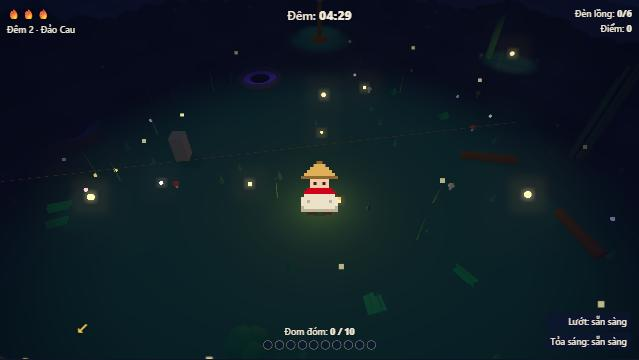

# Mây và Đêm Đảo Bến — v1.0.0 (Phase 4)

> Video demo: _chưa quay_ — xem [docs/demo/README.md](./docs/demo/README.md) (kịch bản quay) và mục "Bằng chứng".



**Yêu cầu hệ thống:** Node.js ≥ 18 + npm; trình duyệt hiện đại có WebGL 2 (Chrome/Edge/Firefox); khuyến nghị GPU rời hoặc iGPU đời gần đây cho 60 FPS ở 1280×720. Headless không cần GPU.

**Mây**, người giữ đèn nhỏ tuổi giữa biển mây, phải nhặt **đom đóm**, thắp và tiếp dầu cho các Đèn Lồng Lớn, đồng thời tránh **Bóng Mực**. Đèn cạn dầu sẽ tắt và vùng an toàn biến mất. Mục tiêu là sống sót tới bình minh với ít nhất 60% số đèn còn sáng.

Game gồm **hai lớp dùng đúng một Simulation Core** (`src/core/simulation.js`):

- **GUI**: trình duyệt (Three.js) đọc state từ core để vẽ; không tự ý đổi logic.
- **Headless**: CLI Node gọi thẳng core, chạy tất định, xuất JSONL theo Test Contract (v1.2 cho luật gameplay, v1.3 thêm bench/soak/bảng xếp hạng).

---

## Quick Start (tối đa 3 lệnh)

Prerequisites: **Node.js ≥ 18** và **npm** (đã kiểm tra trên Node 26). Không cần GPU cho chế độ headless.

On macOS/Linux (or Git Bash), build dependencies and start the game:

```bash
./scripts/build.sh
./scripts/run.sh
```

On Windows PowerShell, run these from the repository folder:

```powershell
npm ci
npm run serve
```

Open `http://localhost:8080/` in your browser. Press `Ctrl+C` in the terminal to stop the server. On macOS/Linux, `run.sh` also attempts to open the browser automatically.

---

## Điều khiển (GUI)

| Hành động | Phím |
|---|---|
| Di chuyển | `W A S D` |
| Nhảy | `Space` |
| Lướt | `Shift` |
| Nạp ánh sáng vào đèn (đứng gần đèn) | `E` |
| Tỏa sáng / đẩy lùi Bóng Mực | `F` |
| Xoay camera | Kéo chuột (bấm giữ + di chuyển); rê chuột để nhìn trước theo hướng con trỏ |
| Tạm dừng / tiếp tục | `Esc` hoặc `P` |
| Chơi lại đêm | Nút **Chơi lại đêm** hoặc `R` |
| Bảng màu dễ phân biệt | Cài đặt → bật **Bảng màu dễ phân biệt** |

**Mục tiêu:** thu thập đom đóm, giữ cho đủ số đèn sáng trong suốt đêm và tránh Bóng Mực. Đèn sáng tiêu thụ 1 dầu/giây; dùng `E` để châm tối đa 10 dầu mỗi đom đóm. Đèn cạn dầu cần 5 đom đóm để thắp lại. Đài Ánh Sáng di động chỉ nạp vào đèn tắt rồi dịch chuyển sau mỗi lần nạp thành công. Đêm 1/2/3 cần giữ sáng ít nhất 3/5, 4/6, 5/7 đèn tương ứng. Thắng sẽ mở đêm tiếp theo; điểm đêm thắng được cộng dồn.

---

## Chế độ headless (Test Contract v1.2)

```bash
./scripts/headless.sh --seed <int> --night <night> \
  [--scenario <file.json>] [--inputs <file.json>] \
  --ticks <int> --out <file.jsonl> [--snapshot-every <int>]
```

- `--seed`, `--night`, `--ticks`, `--out` bắt buộc; `--night` nhận `1`, `2`, hoặc `3`; `--scenario`, `--inputs`, `--snapshot-every` (mặc định 10) tùy chọn.
- Sim ở **60 tick/s cố định**. Exit code: `0` hợp lệ, `2` scenario/input sai schema, `1` lỗi runtime.
- Cùng `--seed` + scenario + inputs → output JSONL **giống hệt từng byte** (dùng PRNG xorshift32 có seed).

Ví dụ thực:

```bash
./scripts/headless.sh --seed 123 --night 1 --ticks 600 --out evidence/headless/demo.jsonl
./scripts/headless.sh --seed 123 --night 3 --ticks 21600 --out evidence/headless/night3.jsonl
./scripts/headless.sh --seed 1 --night 1 --ticks 5 --scenario scenarios/hc04_pickup.json \
  --inputs inputs/hc04_walk_to_mote.json --out evidence/headless/hc04.jsonl --snapshot-every 1
```

On Windows PowerShell:

```powershell
npm run headless -- --seed 1 --night 3 --ticks 21600 --out out.jsonl
```

Cách tái lập quyết định test: chạy cùng lệnh hai lần rồi `cmp` hai file (đã có `evidence/headless/det_a.jsonl` vs `det_b.jsonl`).

---

## Bench, soak, bảng xếp hạng (Phase 4 · Contract v1.3)

**Bench** (đo FPS trên cảnh chuẩn: Đêm 1, 200 Bóng Mực wander, 100 đom đóm, L1–L3 sáng, camera bay vòng R=30 m, Y=15 m, 15 s/vòng; 3 s khởi động rồi đo `--duration` giây):

```bash
./scripts/bench.sh --seed 42 --duration 30 --out bench.json     # hoặc: npm run bench
```

Lệnh bật server cục bộ, mở cửa sổ Chrome/Edge 1280×720 (không toàn màn hình, cờ `--disable-gpu-vsync --disable-frame-rate-limit`), chờ trang gửi kết quả rồi ghi `bench.json` và thoát mã 0. Nếu không tìm thấy Chrome/Edge sẽ mở trình duyệt mặc định (vsync không tắt được → `vsync_off: false`). `--no-open` chỉ in URL để tự mở. Trong cảnh bench, các phần sáng tạo thêm (hậu kỳ HD-2D, lao tới của Bóng Mực, vệt sáng, hố/hàng rào của chế độ arcade) bị tắt; sương mù chiến tranh và ánh sáng giữ nguyên. **Bộ nhớ:** bản web không đo được RSS của tiến trình nên `peak_mem_mb` = `null` (giải thích trong `peak_mem_note`). Ngưỡng đạt: avg ≥ 60 FPS, p1 low ≥ 30 FPS, load ≤ 10 s — kết quả trên máy dev xem [bench.json](./bench.json) (RTX 5070 Ti Laptop, Windows 11, cửa sổ nhúng của Claude desktop — chỉ để tham khảo; máy chấm sẽ đo lại).

**Soak** (10 Đêm liên tiếp, input ngẫu nhiên theo seed, kiểm RSS):

```bash
./scripts/soak.sh --seed 7 --nights 10 --out soak.json          # hoặc: npm run soak
```

Đạt khi `crashes = 0` và `mem_end_mb ≤ 1.2 × mem_start_mb` (mã thoát 0/1). RSS được lấy sau khi ép GC, sau một bước khởi động JIT thuộc phần "tải".

**Bảng xếp hạng**: sau Bình Minh (thắng Đêm 3) hoặc khi thua ở bất kỳ Đêm nào, màn kết quả có ô nhập tên (3–12 ký tự `A-Za-z0-9_`, có hỗ trợ chữ có dấu). Top 10 theo điểm giảm dần (bằng điểm: ai đạt trước đứng trên) lưu ở `data/leaderboard.json` do server ghi (kèm bản dự phòng trong localStorage) nên còn nguyên sau khi tắt/mở lại. Xem từ menu chính → "Bảng xếp hạng". Xuất:

```bash
./scripts/run.sh --export-leaderboard out.json                   # hoặc: npm run export-leaderboard
```

**Dễ tiếp cận** (Cài đặt, được lưu): đổi phím cho cả 9 hành động (báo trùng phím, nút "Khôi phục mặc định"); chú thích chữ + mũi tên mép màn hình cho Bóng Mực xuất hiện, gió sắp thổi, 10 giây cuối, đèn < 30 dầu; "Giảm chuyển động" (tắt rung camera và mọi animation/chớp CSS); "Chữ lớn ×1.25" (chữ UI tối thiểu 18 px); bảng màu dễ phân biệt.

---

## Chạy test

```bash
npm test
```

Chạy kiểm thử contract và regression:

```bash
node tests/contract/edge-cases.js
```

Full-night headless acceptance: `node src/cli.js --seed 1 --night 3 --ticks 21600 --out out.jsonl` phải hoàn tất trong ≤30 giây.

---

## Cách tính điểm

- Nạp mỗi đom đóm vào đèn (thắp, thắp lại, châm dầu): **+5**.
- Thắp lần đầu: **+100**; thắp lại: **+40**.
- Trúng Tỏa Sáng một Bóng Mực: **+5**, hoặc **+15** nếu bóng đang hút dầu.
- Khi **thắng bình minh**: mỗi đèn còn sáng **+50 + floor(dầu)**; mỗi Ngọn Lửa còn **+50**. Không có thưởng thời gian.

Nhặt đom đóm tự nó không cộng điểm; điểm được tính khi nạp vào đèn.

---

## Tuning quan trọng

File **`game.contract.json`** ở thư mục gốc là nguồn tuning duy nhất và **khớp chính xác với code** (có test đối chiếu). Các giá trị chính:

| Field | Giá trị | Ý nghĩa |
|---|---|---|
| `player_speed` | 6.0 | Tốc độ đi (m/s) |
| `carry_capacity` | 10 | Sức chứa ban đầu; tăng 2 mỗi lần thắp thành công, tối đa 20 |
| `lantern_cost` | 10 | Ánh sáng cần cho mỗi đèn |
| `fuel_max` / `fuel_decay_per_s` | 100 / 1.0 | Dầu tối đa và mức hao hụt mỗi giây |
| `fuel_per_mote` / `relight_cost` | 10 / 5 | Dầu mỗi đom đóm và chi phí thắp lại |
| `low_fuel_threshold` | 30 | Ngưỡng đèn mất vùng an toàn và bị Bóng Mực ưu tiên |
| `win_ratio` | 0.6 | Tỷ lệ đèn cần sáng khi bình minh |
| `flames` | 3 | Sức khỏe ban đầu |
| `night1_duration_s` | 240 | Thời lượng Đêm 1 |
| `pulse_cost` / `pulse_radius` / `pulse_stun_ticks` | 3 / 5.0 / 120 | Chi phí, bán kính 3D, thời gian choáng của kỹ năng tỏa sáng |
| `safe_radius` | 6.0 | Bán kính vùng an toàn quanh đèn sáng |
| `shade_speed` | 4.0 | Tốc độ Bóng Mực (Đêm 3: 4.5 m/s) |
| `dash_speed` / `dash_duration_s` / `dash_cooldown_s` | 14 / 0.2 / 1.5 | Tốc độ, thời gian và hồi chiêu lướt |
| `hit_drop_ratio` | 0.5 | Bị đánh rơi `floor(carried / 2)` đom đóm |
| `night2_duration_s` / `night3_duration_s` | 270 / 300 | Thời lượng Đêm 2 và Đêm 3 |

Hằng số vật lý nhảy (`jump_velocity=7 m/s`, `gravity=20 m/s²`) nằm ở `src/core/tuning.js`.

---

## Kiến trúc

```
src/core/           Simulation Core (tất định) + PRNG + tuning
src/contract/       Parser/validate scenario & inputs (+ schema errors)
src/cli.js          Headless mode (argparse, JSONL, exit codes)
src/game/           GUI: server.js, index.html, style.css, main.js (Three.js)
scripts/            build.sh, run.sh, headless.sh
tests/              run-all.js (v1.2 contract + regression)
scenarios/, inputs/ Ví dụ scenario & input
evidence/           Bằng chứng test/headless
game.contract.json  Tuning chuẩn (đồng bộ với code)
docs/phase2-spec.md Acceptance criteria cho Phase 2
```

---

## Sáng tạo của tôi

- **Phase 4 GUI**: camera cao theo nhân vật, sương mù chiến tranh (chỉ ánh sáng xuyên qua), hậu kỳ HD-2D (bloom + tilt-shift + sprite pixel), nhạc nền và SFX thủ tục, hố/hàng rào/đom đóm chạy trốn ở chế độ "arcade" (**chỉ GUI** — headless và contract không đổi).

- **“Đom đóm chúc mừng”**: khi một Đèn Lồng Lớn được thắp, một nhóm đốm sáng vàng bay vòng quanh đèn trong ~2 giây rồi tan dần (hình ảnh thuần trang trí).
- Đây chỉ là **VFX**, không có collider, không nhặt được, không gây sát thương, không tác động AI/điểm/tài nguyên thời gian.
- **Hoàn toàn không được khởi tạo trong headless** — chạy headless output không thay đổi (kiểm chứng ở HC-23).

---

## Bằng chứng kiểm chứng

| Yêu cầu | Cách kiểm chứng | Bằng chứng | Kết quả |
|---|---|---|---|
| Deterministic headless | Chạy cùng seed 2 lần, so byte | `evidence/headless/det_a.jsonl`, `det_b.jsonl` | ✅ giống nhau |
| Contract + regression | `npm test` và edge cases | log | ✅ xem kết quả Phase 3 hiện hành |
| Pickup / deposit / lit / pulse / hit / safe-zone / win / lose | HC-04…HC-19 | `npm test` | ✅ |
| Schema sai → exit 2 | HC-21 | `npm test` | ✅ |
| Tuning khớp contract | Regression | `npm test` | ✅ |
| Bench scene / soak / bảng xếp hạng / phím tùy biến | Nhóm `P4` trong `npm test` | log | ✅ |
| Bench thật (30 s, cảnh chuẩn) | `./scripts/bench.sh` | [bench.json](./bench.json) | ✅ trên máy dev |
| Soak 10 Đêm | `./scripts/soak.sh` | [soak.json](./soak.json) | ✅ |

> Còn thiếu (ghi trung thực): video demo `.mp4` chưa quay; chưa chạy thử trên macOS/Linux; bench chưa đo trên máy chấm của giảng viên.

---

## Giả định & AI usage

**Giả định:** engine là JS thuần + Three.js (không Godot); 3 `flames` ban đầu; mỗi đèn lần đầu cần 10 đom đóm; khởi đầu 20 đom đóm; Đêm 1/2/3 lần lượt 240/270/300 giây. Các luật mới và quyết định phá vỡ tương thích được ghi tại [ADR-003](./docs/adr-003-lantern-fuel-and-dawn-win.md) và [Phase 3 changelog](./docs/phase3-changelog.md).

**AI usage:** project xây dựng bằng trợ lý AI (LM Studio Bionic ở Phase 1–2; Claude Code ở Phase 3–4): brainstorm/kiến trúc, viết Simulation Core + contract + tests + GUI; con người kiểm chứng bằng contract tests, edge cases, và headless run.
